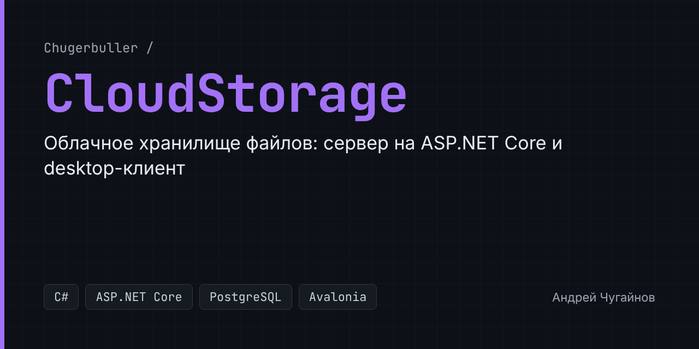

# CloudStorage

Облачное хранилище файлов: сервер на ASP.NET Core и кроссплатформенный desktop-клиент на Avalonia. Пользователь регистрируется, загружает файлы на сервер и управляет ими из клиента.

## Возможности

- Регистрация и вход пользователей, доступ к API по персональному API-ключу.
- Загрузка, скачивание, переименование и удаление файлов.
- Передача больших файлов через SignalR.
- Метаданные файлов и пользователей хранятся в PostgreSQL, схема ведётся миграциями Entity Framework Core.
- Клиент работает на Windows, macOS и Linux.

## Стек

| Часть | Технологии |
|---|---|
| Сервер | C#, .NET 8, ASP.NET Core Web API, Swagger |
| Данные | PostgreSQL, Entity Framework Core (Npgsql), миграции |
| Клиент | Avalonia UI, MVVM (ReactiveUI), HttpClient, SignalR |

## Структура

```text
CloudStore/      ASP.NET Core API: контроллеры файлов и пользователей
CloudStore.BL/   модели, контекст БД, миграции, работа с файлами и пользователями
CloudStore.UI/   desktop-клиент на Avalonia (окна входа и файлового менеджера)
```

## Запуск

1. Поднимите PostgreSQL и укажите строку подключения в `CloudStore/appsettings.json` (`ConnectionStrings`).
2. Примените миграции:

   ```bash
   dotnet ef database update --project CloudStore.BL --startup-project CloudStore
   ```

3. Запустите сервер (Swagger будет доступен по адресу `/swagger`):

   ```bash
   dotnet run --project CloudStore
   ```

4. Запустите клиент:

   ```bash
   dotnet run --project CloudStore.UI
   ```
